<p align="center">
  
</p>

<h1 align="center">SDRCC — SDR Control Center</h1>

<p align="center">
  <strong>Listen · Decode · Analyze · Share</strong>
</p>

<p align="center">
  Radio, ships, aircraft and satellites — brought together in one SDR control center.
</p>

<p align="center">
  
</p>

## 📡 What is SDRCC?

What started with a couple of SDR receivers and the question *“what else can we do with these?”* has grown into **SDRCC**.

SDRCC brings **radio reception, AIS and marine ATIS, ADS-B and satellite missions** together in one browser dashboard. Listen to radio traffic, follow ships and aircraft, plan satellite passes and let SDRCC manage which receiver is needed where.

No cloud platform required. Just radios, antennas, Linux... and probably a few more cables than originally planned. 😄

SDRCC is designed around multiple RTL-SDR receivers, but the logical SDR slots are not tied forever to one physical dongle. Receivers can be replaced or rebound from the dashboard while Receiver Manager handles reservations, temporary handovers and restoration of the previous service.

## 🌍 One screen, several worlds

**✈️ Aircraft · 🚢 Ships · 🛰️ Satellites · 📻 Radio**


**Radio View** gives you the quick picture: aircraft from ADS-B, vessels from AIS and satellites currently moving over the station.

## 🎙️ Wait... which ship was that?

Traffic Voice is where radio audio meets the traffic data SDRCC already has.

In **Marine Voice + AIS**, SDRCC can scan marine VHF channels, decode marine **ATIS (Automatic Transmitter Identification System)** identities and correlate validated ATIS traffic with current AIS vessel data.

When a correlation is found, **Possible Speaker** shows the vessel, callsign and matching information next to the live receiver.


The **Auto** function can follow newly validated matches in the AIS-catcher map. The same map window is reused, and the chosen zoom level is retained.

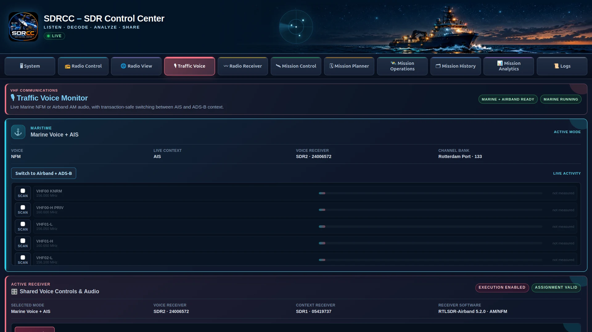

> Hearing marine traffic is fun. Knowing which ship you're hearing makes it a little more interesting. 🚢🎙️

A match depends on the ATIS and AIS information available at that moment, so **Possible Speaker** is exactly what the name says: useful correlation information for the operator, not a claim that every transmission can always be identified.

Traffic Voice also supports **Airband Voice + ADS-B**, fixed-channel listening, channel scanning, scan exclusions, adjustable scan speed, squelch, Smart Gain/manual gain and Excel channel-list import/export.

Recent Marine transmissions can be replayed or saved, with up to four latest receptions available. Speech filtering and noise reduction have separate Marine and Airband preferences, while the ATIS decoding input remains unchanged. A selectable channel filter improves Marine voice reception.

Optional **Ship photos** adds a vessel thumbnail after a validated live ATIS/AIS match, with the photographer/source credit and a clickable link to the original page. **Google Images** remains available as a separate search link.

Vessel photographs are shown only when the relevant photo's use is authorized by the photographer or covered by an appropriate license. A website containing work by multiple photographers is **not** treated as blanket permission. Individual photographer credit, applicable license information, existing watermarks and a link to the original photograph must be retained.

## 📻 Sometimes you just want a radio

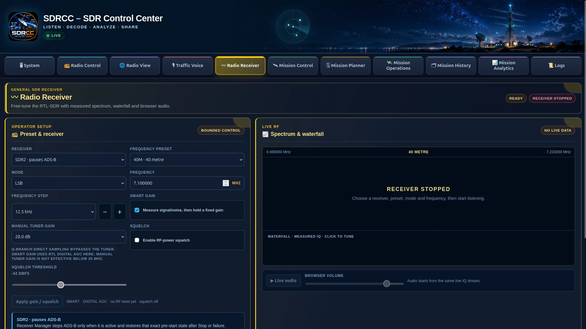

Not everything needs to be a mission.

The built-in **Radio Receiver** turns an available RTL-SDR into a browser-controlled receiver with live audio, spectrum and waterfall.

Tune directly or use presets. Supported modes include **LSB, USB, CW, AM, NFM, FM and WFM**, with tuning steps, click-to-tune, RF-power squelch and Auto Gain/manual gain.

Receiver Manager takes care of borrowing the SDR from another role and restoring its previous job when you're finished.

## 🛰️ Satellites don't wait for you

Fortunately, SDRCC can do the waiting.

**Mission Planner** calculates upcoming passes and applies the reception rules configured for each satellite.

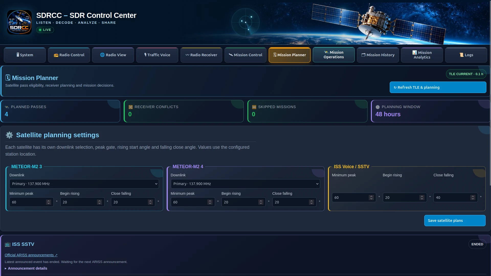

**Mission Control** shows what's coming next, which receiver will be used and what the scheduler is doing.

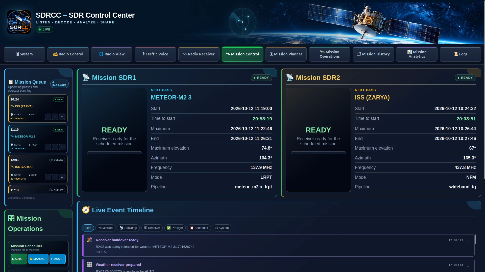

When it's time, SDRCC reserves the required receiver, handles conflicting receiver services and starts the mission. After the pass, the receiver is released and its previous context can be restored.

### And hopefully...

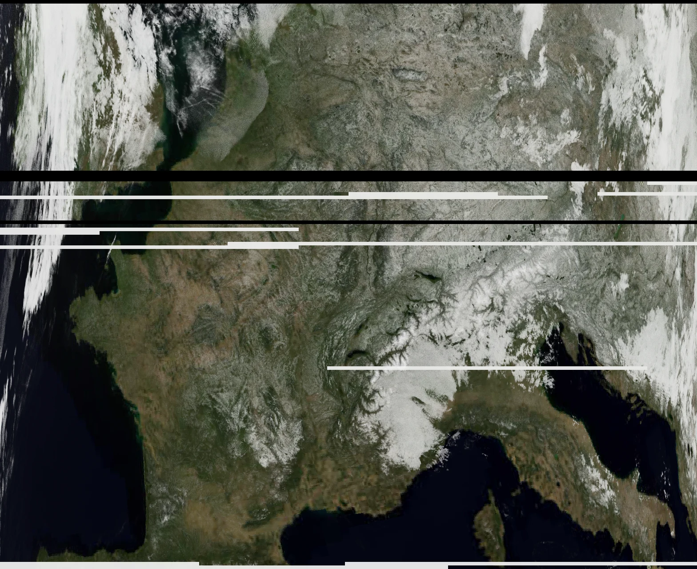

...you get something from space. 🌍📡

**Mission Operations** keeps received products with their mission. Mission History and Mission Analytics provide the deeper view when you want to inspect results, telemetry, Peak SNR and receiver performance.

SDRCC currently supports automated **METEOR-M2 3 / METEOR-M2 4 LRPT** reception through SatDump and **ISS Voice** pass planning and reception.

## 🚢 AIS, ✈️ ADS-B and a bit more

SDRCC doesn't try to reinvent everything.

It connects several excellent open-source radio projects and adds receiver management, automation and one common dashboard around them.

Continuous AIS and ADS-B reception can run alongside temporary jobs such as Traffic Voice, the Radio Receiver and satellite missions. SDRCC's Receiver Manager coordinates the handover when two jobs want the same physical receiver.

## 🔌 Receiver management without the USB-number headache

Physical receivers are mapped to logical **SDR1 / SDR2** slots under **System → Receiver hardware + bindings**.

The receiver identity is kept by serial rather than by a changing USB index. A slot can also be set to **None**, so installation and configuration do not require every receiver to be connected permanently.

Roles such as AIS and ADS-B can be reassigned from the dashboard. SDRCC stops conflicting Traffic Voice activity before applying those assignments so a forgotten voice session does not quietly keep the dongle busy.

## 📡 The antenna side of things

SDRCC is software, but eventually every signal has to come in through some metal in the sky. 😄

The current station uses a **Scan-King Royal Discone 2000** at about **15 metres**, connected with **Ultraflex 7** coax to a **Mini-Circuits ZFSC-4-1** splitter.

From there the RF is shared between:

- **✈️ ADS-B** → NooElec NESDR SMArt v5
- **🚢 AIS** → NooElec LaNA → NooElec NESDR SMArt v5
- **📻 Local listening** → Radtel RT-950 Pro

**Royal Discone → Ultraflex 7 → Mini-Circuits splitter → ADS-B / AIS / Radtel**

It isn't a required SDRCC configuration — just the antenna setup currently feeding the station.

## 🗺️ A little extra around Rotterdam

Some development screenshots may show **VTS Rijnmond sectors and VHF channels** on the AIS-catcher map.

That overlay is a separate EyeVisionsNL project built around public Rijkswaterstaat VTS data. It is not required for SDRCC and is not part of AIS-catcher itself.

It is simply one of those *“wouldn't it be useful if...”* side projects that grew around the station. 😄

## ❤️ Projects that make SDRCC possible

SDRCC stands on the shoulders of some excellent open-source projects. These are independent projects with their own authors, licenses and communities — and they deserve the credit.

| Project | What SDRCC uses it for |
|---|---|
| [SatDump](https://github.com/SatDump/SatDump) | Satellite demodulation, decoding and METEOR LRPT products |
| [AIS-catcher](https://github.com/jvde-github/AIS-catcher) | AIS reception, decoding, statistics and vessel viewer |
| [readsb](https://github.com/wiedehopf/readsb) | ADS-B reception and aircraft data |
| [RTLSDR-Airband](https://github.com/rtl-airband/RTLSDR-Airband) | Marine and Airband Traffic Voice backend |
| [librtlsdr / rtl-sdr](https://github.com/steve-m/librtlsdr) | Access to RTL2832U-based SDR receivers |

If SDRCC is useful to you, please have a look at the upstream projects too. ❤️

## 📷 Vessel photographs and thanks

Thank you to the photographers and websites that make the optional vessel-photo view possible:

| Website | Photo credit and use in SDRCC |
|---|---|
| [Mark Prummel](https://markprummel.nl/) | Photographs by Mark & Chris Prummel, with source credit and a link to the original ship page |
| [Binnenvaartspotter.nl](https://www.binnenvaartspotter.nl/) | Peter's vessel photographs, displayed as thumbnails with permission and a link to the original page |
| [Rensen-Driessen](https://www.rensendriessen.com/building/our-ships/) | Vessel photos used with Wim Driessen's permission; a small Rensen-Driessen logo is displayed on every thumbnail alongside a link to its original ship page |
| [Wikimedia Commons](https://commons.wikimedia.org/) | Vessel photographs with the individual photographer and license shown alongside the image |
| Various vessel photographers | Photographs from various photographers, with the photographer’s name and a clickable link to the original photograph. Existing watermarks remain intact. |

Photographs remain credited to their respective owners. Source links and existing watermarks are retained; permission for SDRCC thumbnails does not grant unrestricted reuse of the photographs. Rensen-Driessen's approved green logo is embedded in the served JPEG when Pillow is available, so saving the displayed image retains the logo. Older installs without Pillow use a visible logo overlay until the imaging dependency is installed. The remote original is unchanged. The Google Images fallback remains a search link only.

A special thank you to **Mbruins** for the many tests, careful feedback and help improving SDRCC. Real-world testing makes a difference. ❤️

## 🔧 Getting started

SDRCC is developed and tested on **Ubuntu Linux x86-64**. Ubuntu Desktop is the main development/test environment; Ubuntu Server can also be used when the dashboard is operated remotely.

The full SDRCC workload is intended for a small x86-64 PC rather than a Raspberry Pi. Raspberry Pi OS is used for some separate EyeVisionsNL AIS experiments and companion projects, but is not the reference SDRCC runtime.

### Fresh installation

Run the installer as your normal Ubuntu user. Do **not** put `sudo` in front of `./install.sh`; the installer requests elevated privileges itself when needed.

```bash
sudo apt-get update
sudo apt-get install -y git
git clone --depth 1 --branch main https://github.com/EyeVisionsNL/SDRCC.git ~/SDRCC
cd ~/SDRCC
./install.sh
```

During installation SDRCC asks for the station name, location, latitude, longitude and altitude. These values are used for station-relative functions such as satellite pass planning.

The installer also guides the AIS-catcher setup. Receiver hardware can be configured later if the SDRs are not connected during installation.

### Existing installation

Current SDRCC installations include the managed updater in **System → Advanced Maintenance**. It checks the published SDRCC update metadata, shows the available version and release notes, and runs the managed update workflow when you explicitly start it.

Local station settings, receiver bindings and runtime data are kept outside the code replacement path.

### AIS setup later

If AIS setup was deferred during installation:

```bash
cd ~/SDRCC
./install.sh --ais-setup
```

Stop active missions and Radio Receiver sessions before running the explicit AIS setup workflow.

### Uninstall

```bash
~/SDRCC/uninstall.sh
```

The receipt-aware uninstall removes SDRCC and removes externally provisioned radio applications only when the installation receipt shows that SDRCC installed them. Shared Ubuntu packages are preserved.

## 🖥️ Dashboard

The navigation brings the station together in one place:

`System · Radio Control · Radio View · Traffic Voice · Radio Receiver · Mission Control · Mission Planner · Mission Operations · Mission History · Mission Analytics · Logs`

**System** handles health, detected hardware, receiver bindings and maintenance.

**Radio Control** shows receiver status, assignments and RF settings.

**Mission History & Analytics** keep the technical detail available without turning the README into an operations manual.

### Screenshots — 14 October 2026

<details>
<summary>System</summary>

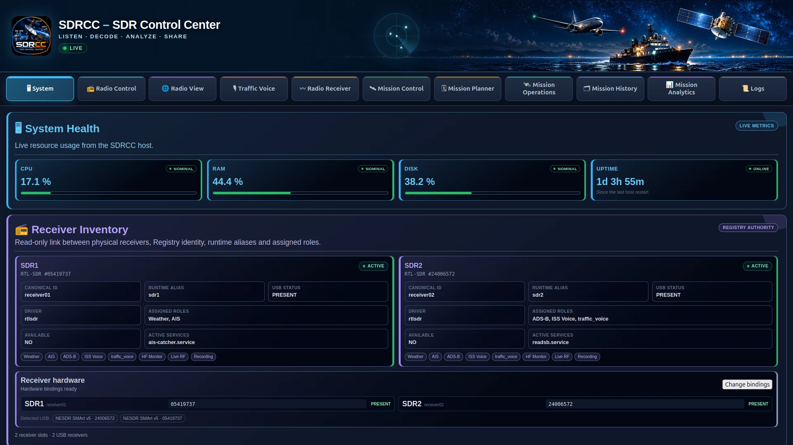

</details>

<details>
<summary>System — services and receiver bindings</summary>

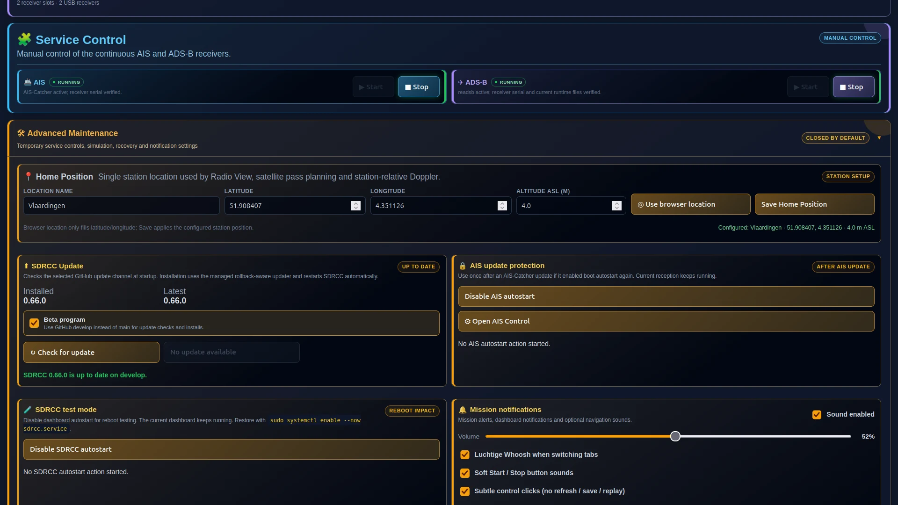

</details>

<details>
<summary>System — maintenance</summary>

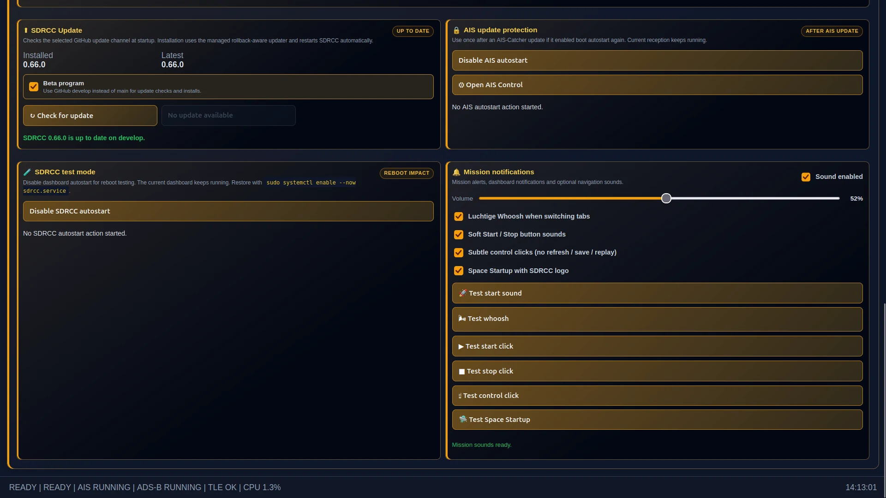

</details>

<details>
<summary>Radio Control</summary>

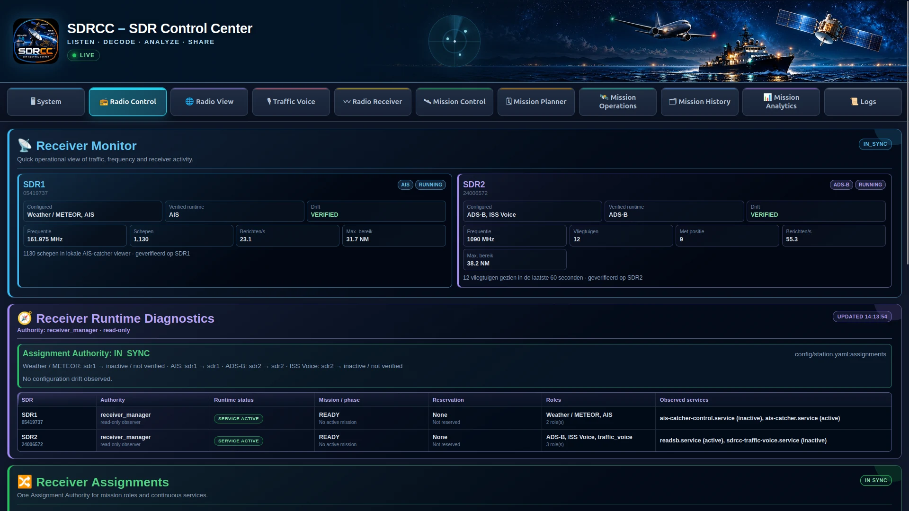

</details>

<details>
<summary>Radio Control — receiver settings</summary>

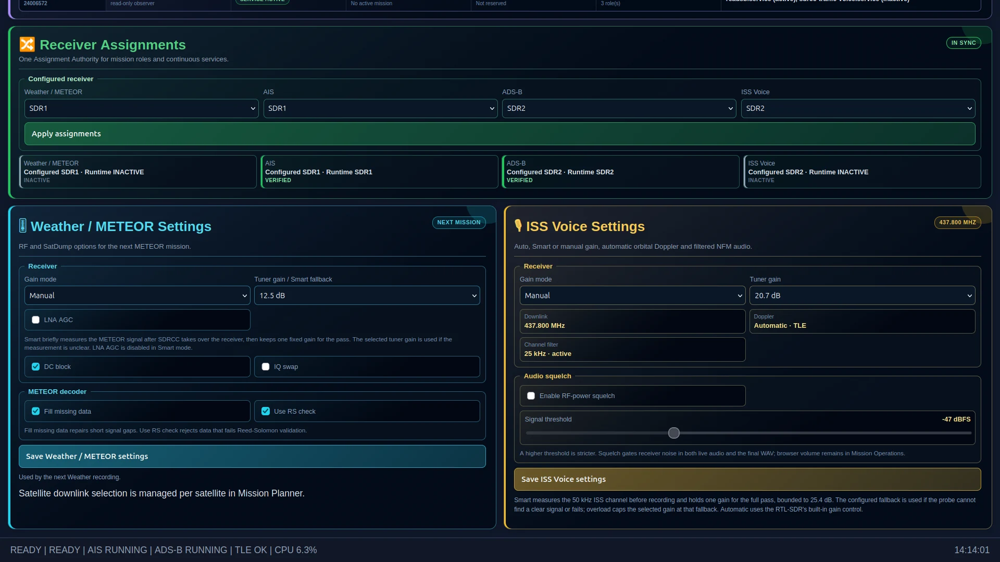

</details>

<details>
<summary>Radio View</summary>


</details>

<details>
<summary>Traffic Voice — idle</summary>

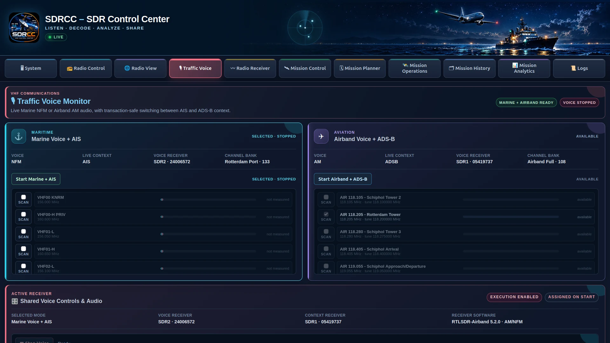

</details>

<details>
<summary>Traffic Voice — channel and audio settings</summary>

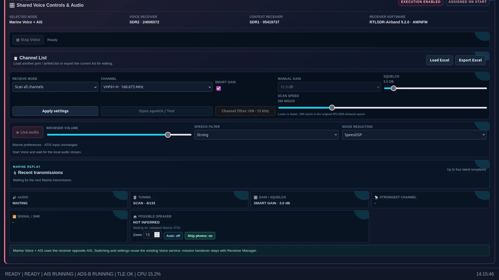

</details>

<details>
<summary>Traffic Voice — Marine</summary>


</details>

<details>
<summary>Traffic Voice — replay, tuning and vessel photo</summary>


</details>

<details>
<summary>Traffic Voice — Airband</summary>

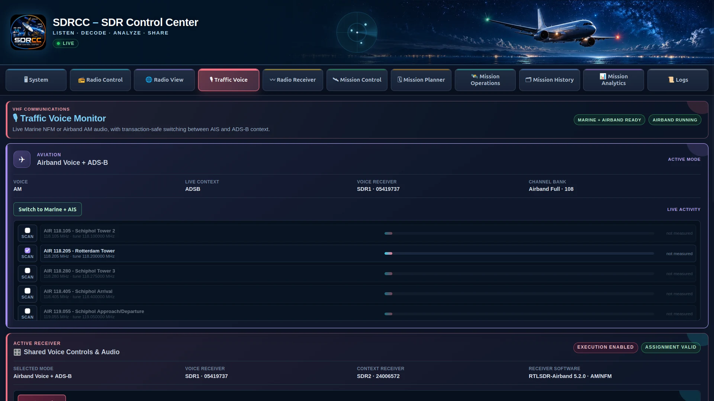

</details>

<details>
<summary>Radio Receiver</summary>


</details>

<details>
<summary>Radio Receiver — tuning and audio settings</summary>

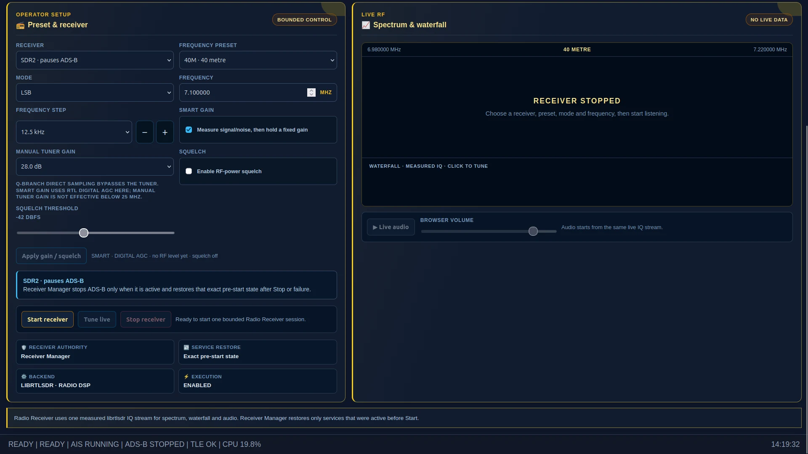

</details>

<details>
<summary>Mission Control</summary>


</details>

<details>
<summary>Mission Control — timeline and journal</summary>

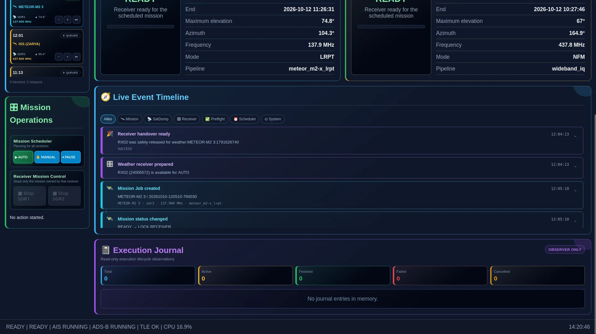

</details>

<details>
<summary>Mission Planner</summary>


</details>

<details>
<summary>Mission Planner — upcoming passes</summary>

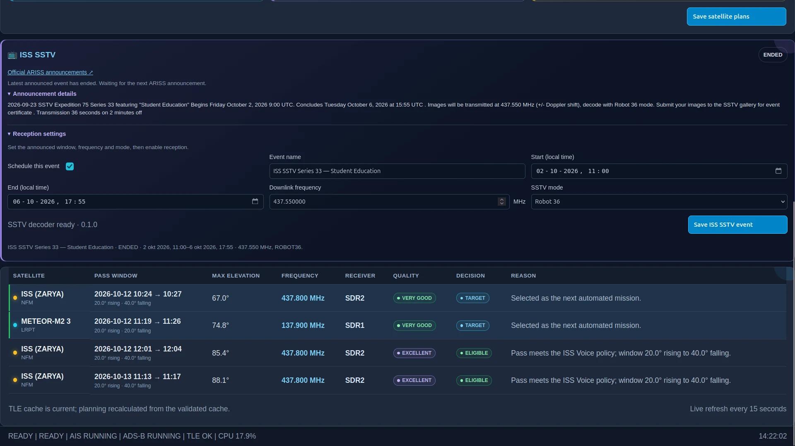

</details>

<details>
<summary>Mission Operations</summary>

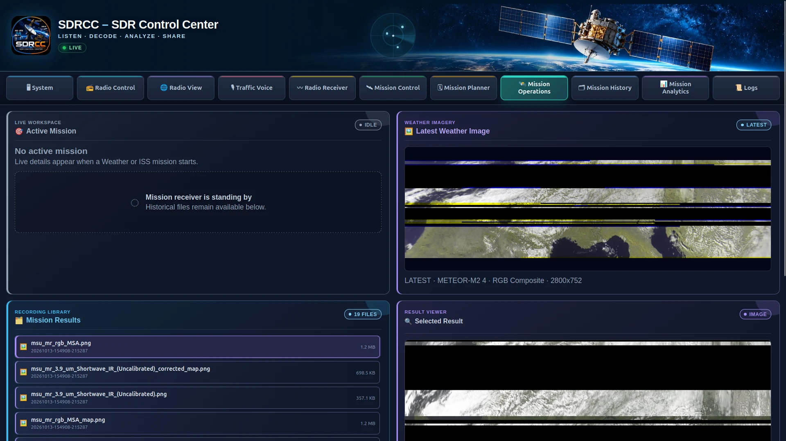

</details>

<details>
<summary>Mission Operations — result viewer</summary>

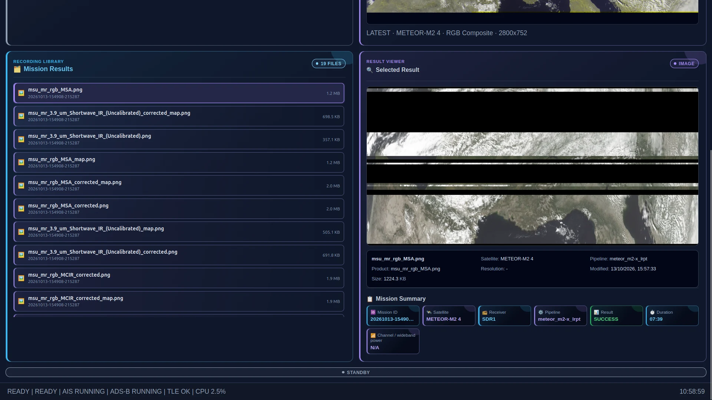

</details>

<details>
<summary>Mission History</summary>

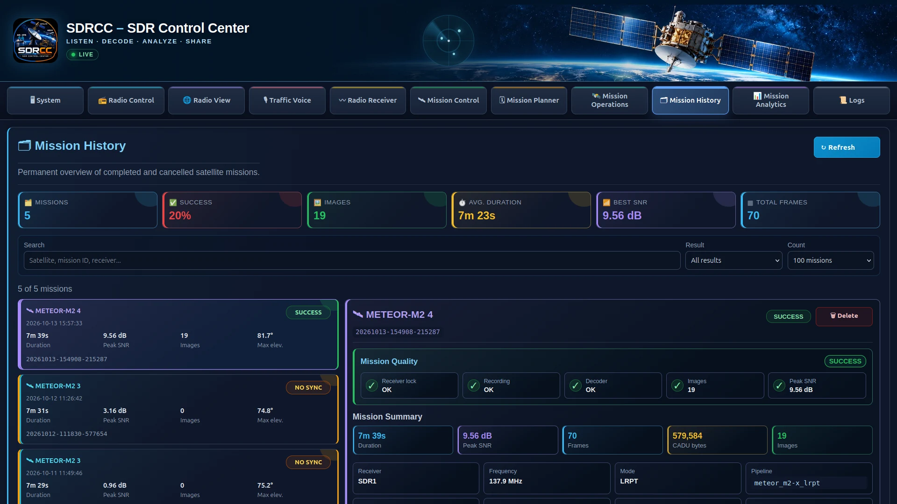

</details>

<details>
<summary>Mission History — received images</summary>

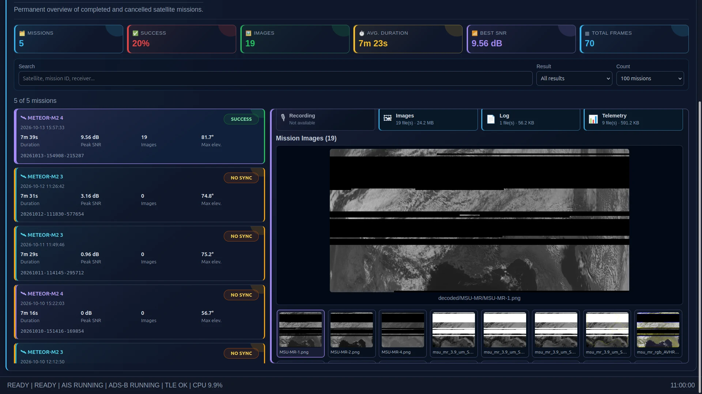

</details>

<details>
<summary>Mission Analytics</summary>

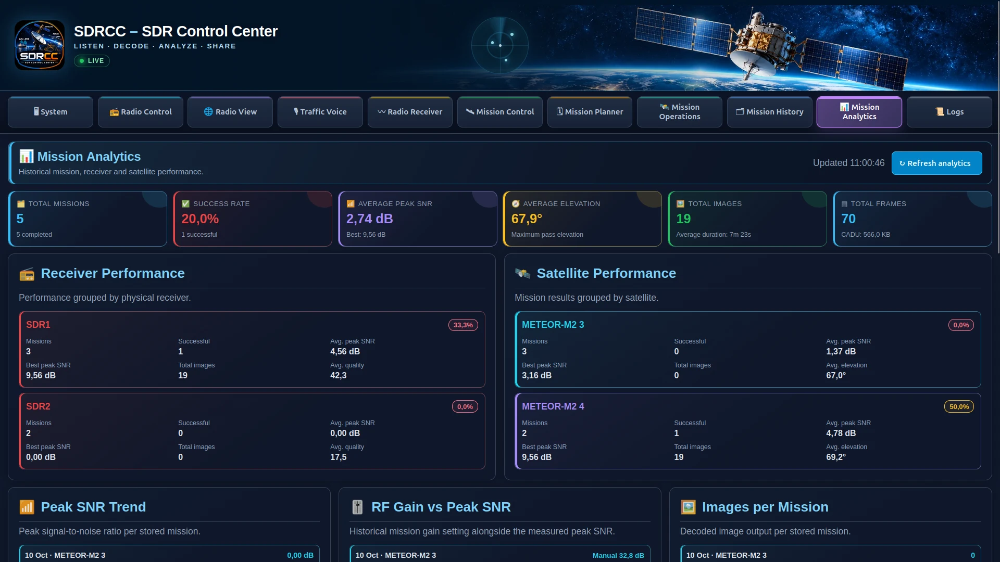

</details>

<details>
<summary>Mission Analytics — outcomes and quality</summary>

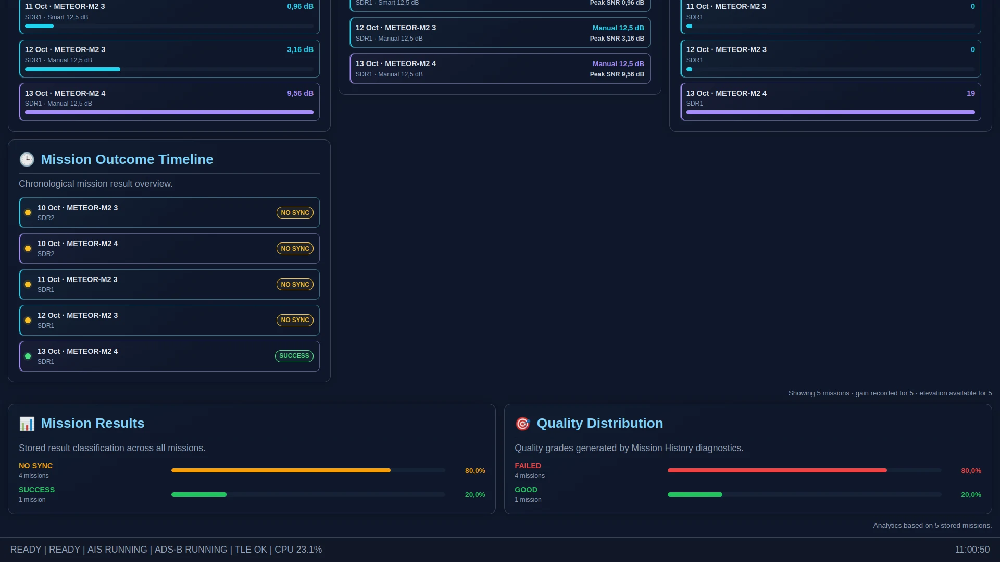

</details>

<details>
<summary>Logs</summary>

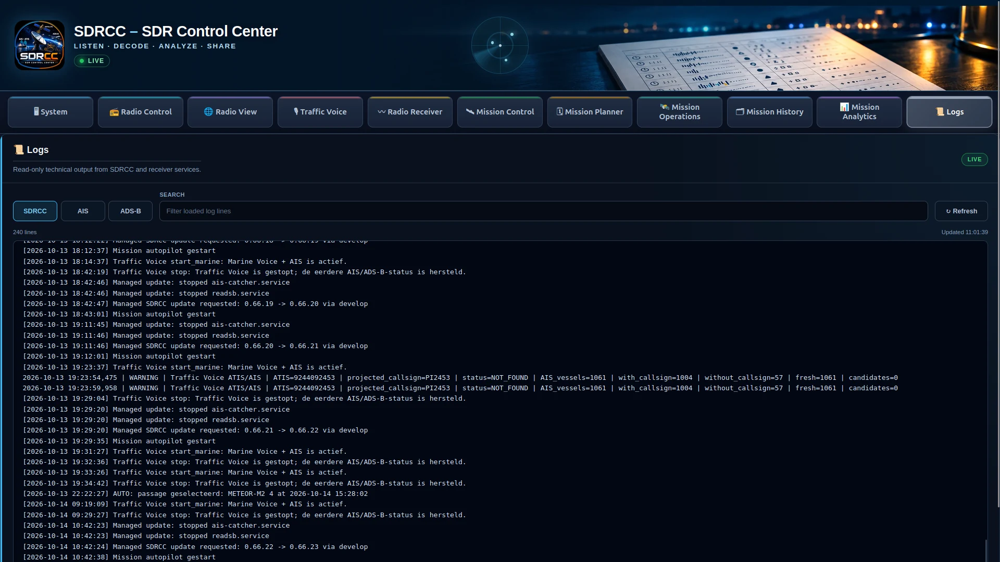

</details>

## 📱 SDRCC Mobile — remote companion for Android

**SDRCC Mobile is an optional companion app for remote access — not a replacement for the full SDRCC desktop dashboard.** SDRCC continues to run on your Ubuntu Linux computer or server. The phone connects to that existing station over trusted Wi-Fi or a private Tailscale VPN.

Use the Android app to **remotely view and listen** to what's happening at your station: follow AIS vessels and ADS-B aircraft, inspect validated ATIS/AIS matches and vessel photographs, listen to Marine Voice and replay recent recordings, view satellite information and check system status. It also offers **selected remote controls**, such as starting or stopping supported reception services and controlling the existing automatic mission schedule.

**Not the full SDRCC interface:** receiver hardware setup and bindings, full Radio Receiver controls, mission planning, detailed mission history and analytics, and SDRCC server installation, maintenance and updates remain in the main desktop dashboard. The Android **↓** update button updates only the Android app — not the SDRCC server.


**[Download SDRCC Mobile v2.0.0 (signed APK)](https://github.com/EyeVisionsNL/SDRCC/releases/download/sdrcc-mobile-v7/SDRCC-Mobile.apk)** · **[Step-by-step installation and settings](android/README.md)**

The official APK is distributed as a permanently signed GitHub Release. Install it on an Android phone, enter the address of the computer running SDRCC (for example `192.168.1.50:8080`), and connect on your local network or with Tailscale. In the AIS map's plugin selector, enable **VTS sector** and **SDRCC ATIS** where available. The step-by-step guide covers first-time installation and remote connections.

The **↓** button checks for newer signed Android APKs and opens the trusted release download in your phone's browser. Android always asks before installing an update; existing app settings are kept when updating a version signed with the same key.

<p align="center">


</p>

### Android screenshots — 14 October 2026

<details>
<summary>Connect to your station</summary>

Enter your SDRCC computer's address with **IP-adres wijzigen**. Use trusted local Wi-Fi or connect both the phone and SDRCC computer through Tailscale.

<p align="center">

</p>

</details>

<details>
<summary>Marine, AIS and recordings</summary>

Start or stop Marine Voice and AIS independently. An ATIS/AIS match highlights the vessel without moving the map. Tap the vessel for details, follow the photo credit to the original, or listen to and save recent recordings.

<p align="center">


</p>

</details>

<details>
<summary>Aircraft</summary>

Control ADS-B reception and view aircraft on the embedded map.

<p align="center">

</p>

</details>

<details>
<summary>Satellites and missions</summary>

View satellite positions, upcoming missions and the latest received image. Enable or disable automatic scheduling, or stop an active mission. Planning and manual mission starts remain in the main SDRCC desktop dashboard.

<p align="center">


</p>

</details>

<details>
<summary>System and settings</summary>

Check service status and system usage. Open **Settings → Map Connections** to change map addresses.

<p align="center">


</p>

</details>

On the AIS map, enable the **VTS sector** and **SDRCC ATIS** plugins in the plugin selector. [Android installation and connection guide](android/README.md#download-and-install).

Technical architecture and internal validation notes remain on the `develop` branch; the stable `main` branch is installation-focused.

## 🧪 Still evolving

The current SDRCC stable release is **v0.67.19** and the signed Android app is **v2.0.0**.

Recent development changes include:

- Improved marine ATIS decoding with tone filtering, bounded soft correction, international identity handling and shared decoder logic with AIS-ATIS-Bridge.
- Smart Gain, a selectable Marine channel filter, recent-transmission replay/save and updated Excel channel lists with marine data channels excluded from voice scanning.
- Optional matched-vessel photographs with individual photographer attribution, original source links and verified permissions or compatible licenses.
- Emergency Monitor detects eligible rescue/police aircraft and KNRM/water-police vessels with configurable alerts, while Advanced Maintenance has a collapsible SDRCC-themed control panel.
- Rensen-Driessen vessel photos appear with the company's approved logo, photographer/source credit and the original ship-page link.
- More reliable managed updates and receiver handovers, with station settings preserved.
- New compact panoramic banners for the dashboard tabs, with the animated radar centered. Traffic Voice shows a ship and aircraft while stopped, then the corresponding scene during Marine or Airband reception. Radio Receiver has its own antenna-mast background.

These changes are tested on `develop` before being promoted to `main`.

A lot of its features came from actually using the station: receivers fighting over the same dongle, wondering which vessel was talking, missing a satellite pass, wanting to borrow the ADS-B receiver as an ordinary radio...

Usually the next feature starts with:

**“Wouldn't it be nice if...”**

...and then somehow turns into another button. 😄

Development happens on the `develop` branch first. Changes are reviewed and validated before they move to `main`.

---

<p align="center">
  <strong>SDRCC — SDR Control Center</strong><br>
  Radio · AIS · ATIS · ADS-B · Satellites
</p>
