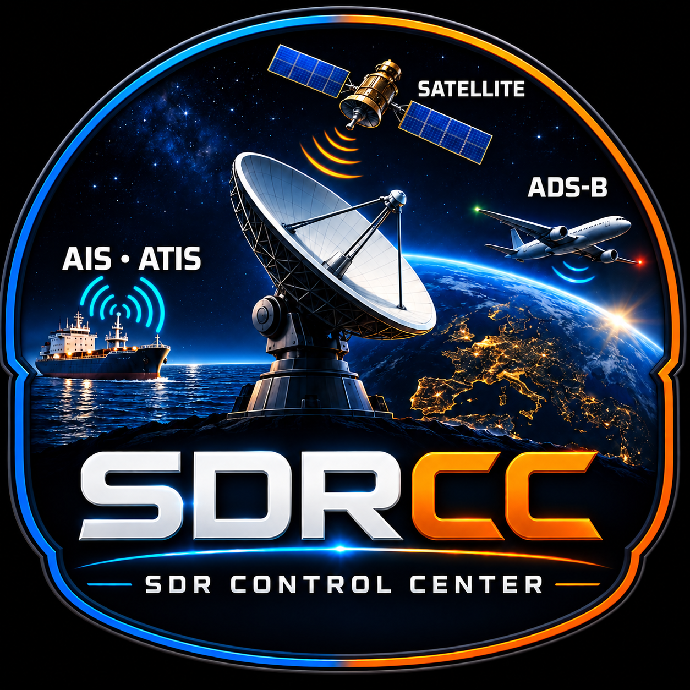
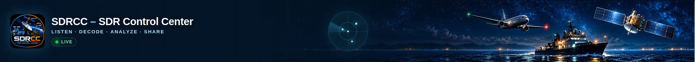
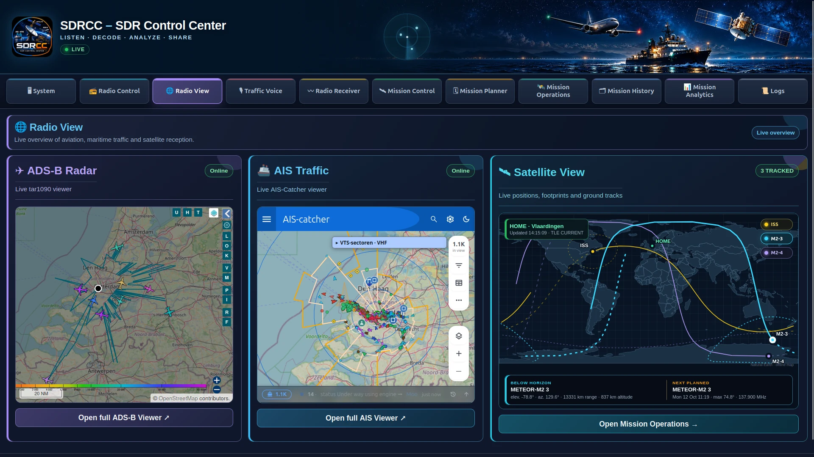
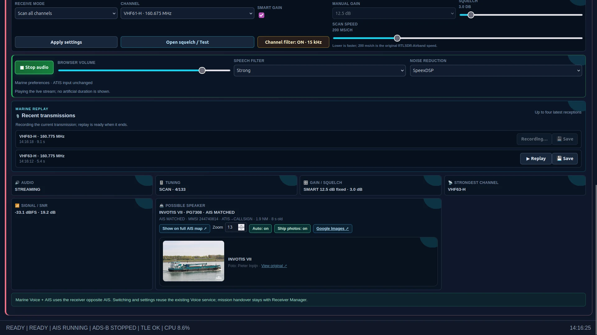

<p align="center">
  
</p>

<h1 align="center">SDRCC — SDR Control Center</h1>

<p align="center">
  <strong>Listen · Decode · Analyze · Share</strong><br>
  Radio, ships, aircraft and satellites — one station, one dashboard.
</p>

<p align="center">
  
</p>

<p align="center">
  <a href="https://eyevisionsnl.github.io/SDRCC/"><strong>📖 Documentation & Wiki</strong></a> ·
  <a href="https://eyevisionsnl.github.io/SDRCC/installation.html"><strong>🔧 Installation guide</strong></a> ·
  <a href="https://eyevisionsnl.github.io/SDRCC/android-companion.html"><strong>📱 Android guide</strong></a> ·
  <a href="https://github.com/EyeVisionsNL/SDRCC/discussions"><strong>💬 Discussions</strong></a>
</p>

## 📡 What is SDRCC?

**SDRCC** brings multiple RTL-SDR receivers together in a browser-based control center. Listen to marine and aviation radio, track vessels and aircraft, receive satellite signals and let **Receiver Manager** coordinate the radios.

No cloud service required — just an Ubuntu PC, compatible receivers and antennas. 🚀

### One station, several worlds

- **🚢 Marine VHF + AIS:** Listen or scan channels, decode validated ATIS identities, see a *Possible Speaker*, replay recent transmissions and optionally view credited ship photographs.
- **✈️ Airband + ADS-B:** Hear aviation traffic and follow aircraft data.
- **📻 Radio Receiver:** Direct tuning, spectrum, waterfall and live browser audio.
- **🛰️ Satellite missions:** Plan passes, automate supported receptions and browse received images and mission results.
- **🔌 Receiver Manager:** Assign SDRs by serial number and manage temporary receiver handovers.
- **🚁 Emergency Monitor:** Optional alerts for configured emergency aircraft and vessels.



## 🎙️ Which ship was speaking?

SDRCC can match a **validated marine ATIS identity** against current AIS vessel data. The result is labelled **Possible Speaker** because not every transmission can be identified with certainty.



[Explore Marine Voice, ATIS and the AIS map →](https://eyevisionsnl.github.io/SDRCC/marine-and-atis.html)

## 📚 Guides — the details live in the Wiki

| Guide | What you'll find |
| --- | --- |
| [🔧 Installation](https://eyevisionsnl.github.io/SDRCC/installation.html) | Requirements, setup and first dashboard login |
| [🔌 First steps](https://eyevisionsnl.github.io/SDRCC/first-steps.html) | Receiver bindings and first reception |
| [🚢 Marine & ATIS](https://eyevisionsnl.github.io/SDRCC/marine-and-atis.html) | VHF, ATIS/AIS matching, recordings and vessel photos |
| [📻 Radio & aircraft](https://eyevisionsnl.github.io/SDRCC/radio-and-aircraft.html) | Radio Receiver, Airband and ADS-B |
| [🛰️ Satellite missions](https://eyevisionsnl.github.io/SDRCC/satellite-missions.html) | Mission Planner, reception and results |
| [📱 Android app](https://eyevisionsnl.github.io/SDRCC/android-companion.html) | Mobile installation, maps and remote access |
| [🛠️ Updates & help](https://eyevisionsnl.github.io/SDRCC/updates-and-troubleshooting.html) | Stable/Beta updates and troubleshooting |

**[Open the complete SDRCC Wiki →](https://eyevisionsnl.github.io/SDRCC/)**

## 🚀 Quick installation

SDRCC is developed and tested on **Ubuntu Linux x86-64** (Desktop or Server). Full SDRCC is intended for a PC, not a Raspberry Pi.

Run these commands as your normal Ubuntu user:

```bash
sudo apt-get update
sudo apt-get install -y git
git clone --depth 1 --branch main https://github.com/EyeVisionsNL/SDRCC.git ~/SDRCC
cd ~/SDRCC
bash install.sh
```

**Run `bash install.sh` without `sudo`.** On Ubuntu Desktop, the SDRCC Installer opens automatically. Choose your features, complete the AIS-catcher wizard and click **Verify AIS setup**. Keep the AIS RTL-SDR serial number handy: you must enter it in the AIS-catcher wizard before **Save & Close**. SDRCC receiver bindings and Home Position can be adjusted later.

Already installed? Use **System → Advanced Maintenance** for updates. [Installation details and troubleshooting →](https://eyevisionsnl.github.io/SDRCC/installation.html)

## 📱 SDRCC Mobile

The optional **Android companion** connects to your running SDRCC station over trusted Wi-Fi or private Tailscale. Follow AIS and ADS-B, listen to Marine Voice, replay recordings and view satellite information. Full receiver configuration and mission planning remain on the desktop.

<p align="center">
  
  
  
</p>

[📲 Download the signed Android APK](https://github.com/EyeVisionsNL/SDRCC/releases/download/sdrcc-mobile-v7/SDRCC-Mobile.apk) · [Android Wiki guide](https://eyevisionsnl.github.io/SDRCC/android-companion.html)

## ⚓ Only interested in marine radio?

Already running **AIS-catcher** with a spare RTL-SDR? **[AIS-ATIS Bridge](https://github.com/EyeVisionsNL/AIS-ATIS-Bridge)** is a lighter, separate project for Marine VHF, ATIS decoding and AIS vessel matching — no satellite or aircraft setup required.

**[Explore the AIS-ATIS Bridge guide →](https://eyevisionsnl.github.io/AIS-ATIS-Bridge/)**

## ❤️ Credits & acknowledgements

SDRCC builds on excellent independent open-source projects: [AIS-catcher](https://github.com/jvde-github/AIS-catcher), [SatDump](https://github.com/SatDump/SatDump), [readsb](https://github.com/wiedehopf/readsb), [RTLSDR-Airband](https://github.com/rtl-airband/RTLSDR-Airband) and [librtlsdr](https://github.com/steve-m/librtlsdr). Each retains its own authors and license.

Thanks to the vessel photographers and photo providers, including [Mark & Chris Prummel](https://markprummel.nl/), [Binnenvaartspotter.nl](https://www.binnenvaartspotter.nl/), [Rensen-Driessen](https://www.rensendriessen.com/building/our-ships/), [Wikimedia Commons](https://commons.wikimedia.org/) and other credited photographers. Photos remain the property of their respective rights holders. Thumbnails require permission or an appropriate license; source links, photographer credits and existing watermarks are retained. Approved Rensen-Driessen images carry the company's logo.

Special thanks to **Mbruins** for extensive testing and feedback. ❤️

## 📜 License & community

**Original SDRCC software:** GNU GPL-3.0-only — see [LICENSE](LICENSE). © 2026 EyeVisionsNL. The SDRCC logo, project branding and original project graphics are EyeVisionsNL assets. Third-party software, data and photographs have their own rights: [THIRD_PARTY_NOTICES.md](THIRD_PARTY_NOTICES.md).

**Stable:** SDRCC v0.68.4 · **Beta:** SDRCC v0.68.15 (`develop`, live emergency vessel and ATIS map overlays) · **Android:** v2.0.2.

[💬 Questions and ideas](https://github.com/EyeVisionsNL/SDRCC/discussions) · [🐛 Report an issue](https://github.com/EyeVisionsNL/SDRCC/issues) · [📖 Wiki](https://eyevisionsnl.github.io/SDRCC/)
