# SDRCC Mobile — Android v2.0.0

**Official signed APK:** [Download SDRCC-Mobile.apk (v2.0.0)](https://github.com/EyeVisionsNL/SDRCC/releases/download/sdrcc-mobile-v7/SDRCC-Mobile.apk)

SDRCC Mobile is the Android companion to the existing SDRCC server. It shows the same live data as the mini-PC: Marine Voice, AIS and ATIS matches, recordings, aircraft, satellite passes, mission controls, and service status. It does **not** install or run a second receiver server.

## 1. Install the app on your phone

1. Use an Android phone with Android 8.0 or later.
2. Open the **official signed APK** link above in your Android browser.
3. Open the downloaded `SDRCC-Mobile.apk`. If Android asks, allow installation from this browser.
4. Tap **Install**. Start **SDRCC Mobile**.
5. Enter the address of your running SDRCC mini-PC, for example `192.168.1.50` or `192.168.1.50:8080`, and tap **Verbinden met SDRCC**.

Only enter a station address you control. The phone must be on the same trusted Wi-Fi network or connected to the private Tailscale network as your mini-PC. The mini-PC runs SDRCC on HTTP port 8080; AIS-Catcher normally uses 8119, and readsb/tar1090 uses port 80.

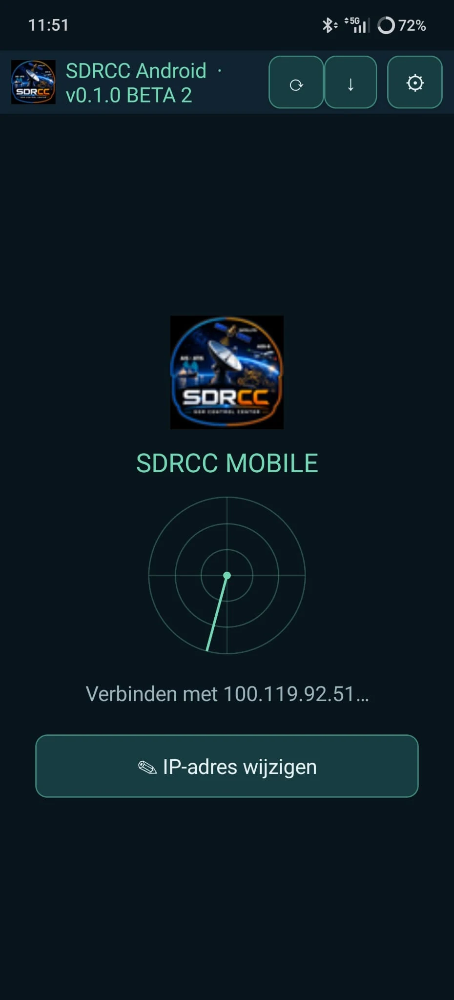

If the station is temporarily unreachable, select **IP-adres wijzigen** on the radar connection screen. Use **Adres bewerken** or **Wissen** to correct the saved address. The app also reports relevant Android/WebView connection failures.

## 2. Configure the live AIS map

1. Open the **Marine** tab in SDRCC Mobile.
2. Start the appropriate SDRCC Marine Voice and/or AIS service if required; they remain independent.
3. Open the live AIS map. In the AIS-Catcher map's **plugin selector**, enable **VTS sector** (Rijnmond sector overlay) and **SDRCC ATIS** (highlight of a validated ATIS/AIS vessel match).
4. If the map does not connect, go to **System → Settings → Map Connections** and check the AIS-Catcher Map URL (`http://mini-pc:8119/`). Correct it, then select **Save Map Addresses**.
5. For ADS-B, verify the ADS-B Map URL (`http://mini-pc/tar1090/`) from the same settings.

The ATIS match only highlights the correct AIS vessel on the map; the map does not automatically jump or re-center. Tap the vessel yourself to inspect details and source-linked photographs. The Rijnmond sector and ATIS overlay may need to be selected again in the map plugin selector when configuring a new installation.

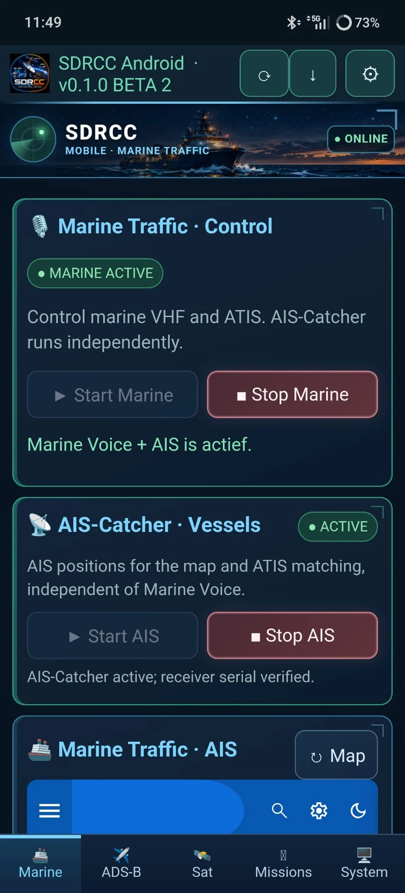
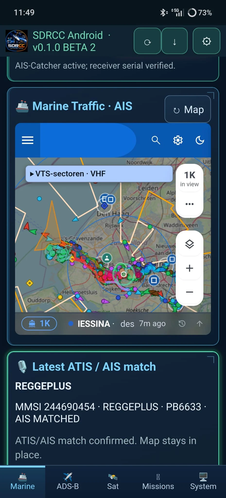
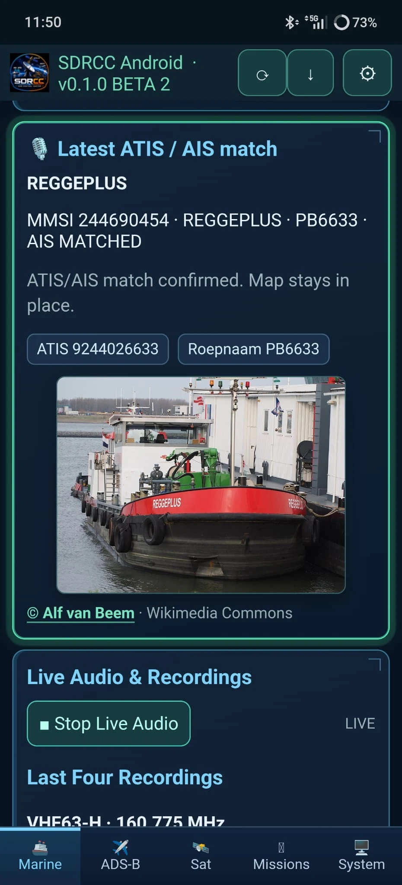

## 3. Use the other mobile features

Marine recordings can be replayed and saved while live reception continues. ADS-B, satellites, future passes, active missions and service status are available through their own tabs. Mission planning, Analyze, History and desktop-only maintenance remain on the mini-PC.

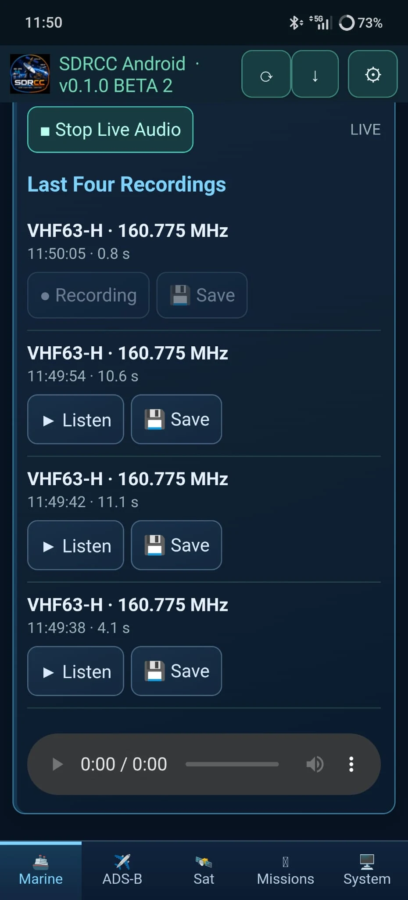
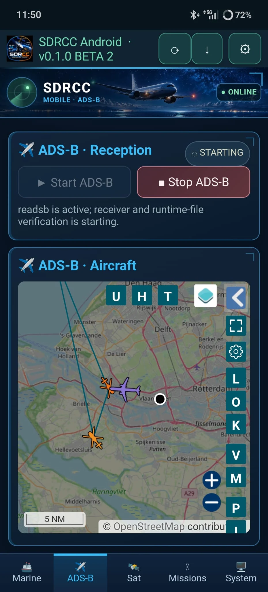
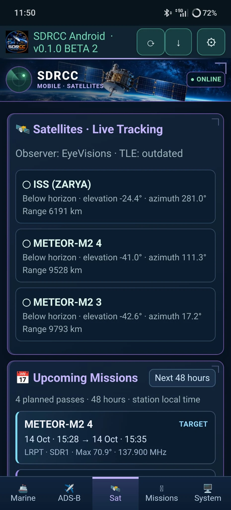
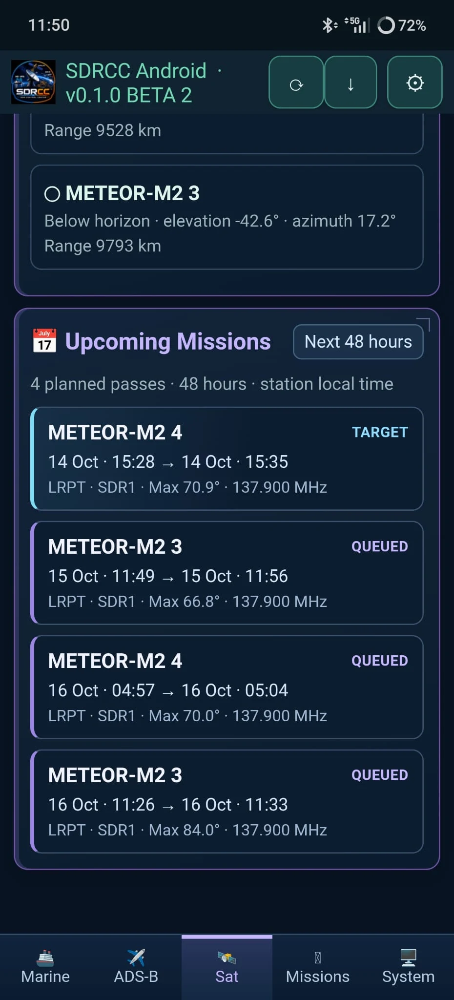
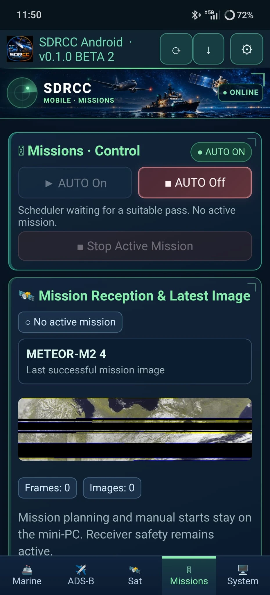
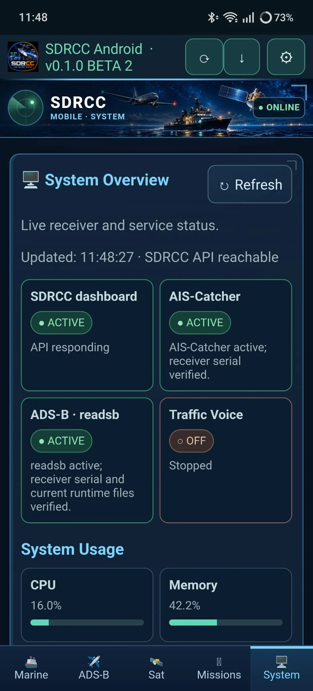
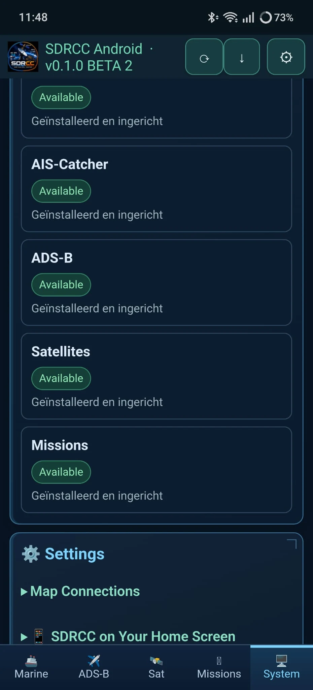

## 4. Update SDRCC Mobile (without uninstalling)

1. Open **SDRCC Mobile** and tap **↓** in the top toolbar. This is also available as **App-update controleren** on the connection screen.
2. The stable v2.0.0 app reads `android/update.json` from the public **main** branch over HTTPS, separately from the station's private SDRCC API.
3. If there is a newer signed version, tap **APK openen**. The official versioned GitHub Release APK opens in the phone browser.
4. Open the downloaded APK and choose **Update / Bijwerken**, **not Uninstall / Verwijderen**.
5. Launch SDRCC Mobile. Your saved mini-PC address and Android app settings should still be present.

The **signed v0.1.0-beta2 (code 5) → signed v0.1.0-beta3 (code 6)** update was successfully tested on an Android phone without uninstalling. The release uses the same permanent signing key, with **v2.0.0 (code 7)** as its new public version. The button never silently installs APKs, and an Android update never stops the mini-PC receiver services.

**Important:** do not use older debug APKs found in CI artifacts or the historical `android/SDRCC-Mobile.apk` path: they may use temporary, incompatible signing keys. The official GitHub Release link above is the supported download location.

## 5. Technical details

- Android package: `nl.eyevisions.sdrcc.mobile` · version name: `2.0.0` · versionCode: `7`.
- Android 8.0 minimum (`minSdk 26`); Java 17, Gradle 8.9, Android Gradle Plugin 8.7.3 and compile SDK 35 to build.
- Open `android/` in Android Studio, or run `gradle :app:testDebugUnitTest :app:assembleDebug` from that directory. Debug builds are **not** stable upgrade packages.
- The production APK is built and signed by **SDRCC Mobile Signed Release** using the repository's protected Android signing secrets, then published as an immutable GitHub Release. New versions must increase `versionCode`.
- The app requests only Android INTERNET permission. It has no JavaScript-to-native bridge, camera, microphone, or unrestricted WebView file access. Links to external photographers open in the phone browser.
- SDRCC and the embedded maps communicate over HTTP on your trusted LAN or private encrypted Tailscale VPN. Do not expose the station to the public internet with port forwarding.
- Keep a **secure offline backup** of your private Android signing keystore and passwords. Never add the `.p12` file, secret contents, or passwords to GitHub source control or support messages.

**SDRCC v0.67.0** on the mini-PC and **SDRCC Mobile v2.0.0** on Android are two separate version numbers. Update SDRCC itself with **System → Advanced Maintenance** on the mini-PC; use the Android **↓** button only to update the phone app.
